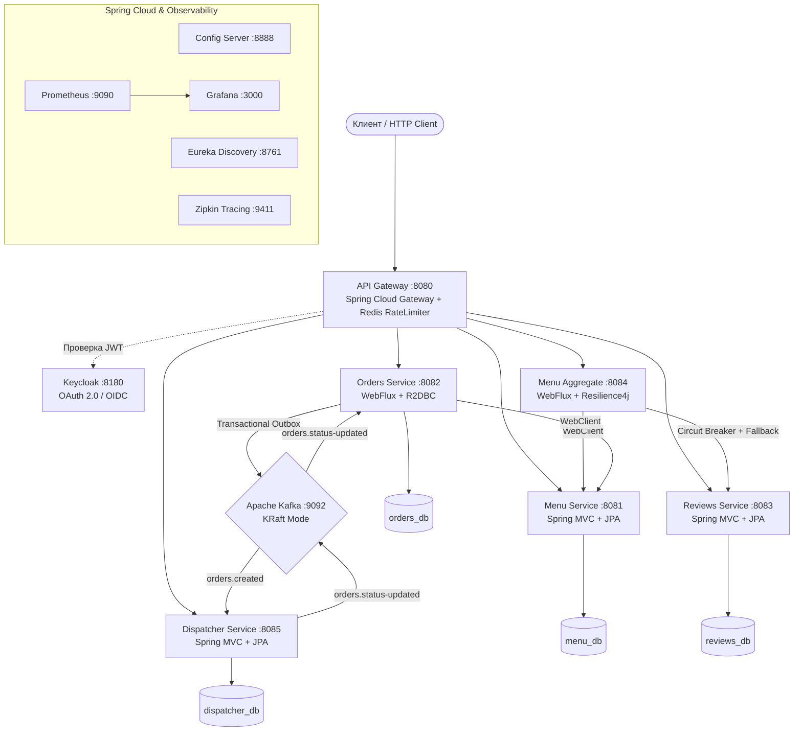

# 🍔 Food Delivery Cloud

Микросервисная платформа для заказа еды на вынос, построенная на стеке **Java 21**, **Spring Boot 3.4**, **Spring Cloud**, **Apache Kafka** и **Keycloak**. Проект сочетает императивный и реактивный подходы, паттерны отказоустойчивости и событийно-ориентированную архитектуру.

---

## 🏗 Архитектура системы

Система разделена на два логических контура: **инфраструктурный слой** (маршрутизация, безопасность, конфигурация, обнаружение сервисов, мониторинг) и **бизнес-микросервисы** с изолированными базами данных (**Database per Service**).



---

## 📊 Карта сервисов и инфраструктуры

### Бизнес-микросервисы

| Сервис | Порт | Стек технологий | База данных | Назначение и ключевые паттерны |
| :--- | :---: | :--- | :--- | :--- |
| **`menu-service`** | `8081` | Spring MVC, Data JPA, Flyway, MapStruct | `menu_db` | Управление меню. Динамическая фильтрация через **JPA Criteria API**, валидация и ответы об ошибках по стандарту **RFC 7807 (`ProblemDetail`)**. |
| **`orders-service`** | `8082` | Spring WebFlux, Project Reactor, R2DBC | `orders_db` | Прием заказов на неблокирующем стеке. Проверка цен в `menu-service` через `WebClient`, паттерн **Transactional Outbox** для отправки событий в Kafka. |
| **`reviews-service`** | `8083` | Spring MVC, Data JPA, PL/pgSQL | `reviews_db` | Отзывы и оценки. Автоматический пересчет среднего рейтинга через **триггеры PostgreSQL** и расчет **байесовского взвешенного рейтинга**. |
| **`menu-aggregate-service`** | `8084` | Spring WebFlux, Resilience4j | — | Композитор меню и рейтингов (`Mono.zip`). Защита от сбоев через **Circuit Breaker**, **Retry** и **Fallback** (Graceful Degradation). |
| **`dispatcher-service`** | `8085` | Spring MVC, Data JPA, Spring Kafka | `dispatcher_db` | Назначение курьеров и управление статусами доставки через асинхронный обмен событиями с `orders-service`. |

### Инфраструктурные компоненты

| Компонент | Порт | Технология | Назначение |
| :--- | :---: | :--- | :--- |
| **`api-gateway`** | `8080` | Spring Cloud Gateway, Redis, OAuth2 | Единая точка входа, балансировка (`lb://`), проверка JWT-токенов и **Rate Limiting** (10 req/s, burst 20). |
| **`discovery-server`** | `8761` | Netflix Eureka Server | Реестр микросервисов и Service Discovery. |
| **`config-server`** | `8888` | Spring Cloud Config (Native) | Централизованное хранение конфигураций (`config-repo`). |
| **`keycloak`** | `8180` | Keycloak 26 (`keycloak_db`) | Авторизация и аутентификация (Realm `food-delivery`, роли `USER` и `ADMIN`). |
| **`kafka`** | `9092` | Apache Kafka 3.9 (KRaft) | Брокер сообщений без Zookeeper (топики `orders.created`, `orders.status-updated`). |
| **`zipkin`** | `9411` | OpenZipkin + Micrometer Tracing | Распределенная трассировка запросов сквозь все микросервисы. |
| **`prometheus` / `grafana`** | `9090` / `3000` | Prometheus + Grafana | Сбор технических метрик JVM/HTTP (`/actuator/prometheus`) и визуализация дашбордов. |

---

## 🛠 Реализованные этапы и архитектурные нюансы

### Этап 1. Монорепозиторий и Docker Compose

* Сборка организована на **Gradle Multi-Project (Groovy DSL)** с единым каталогом версий `gradle/libs.versions.toml` и управлением зависимостями через BOM Spring Boot 3.4 и Spring Cloud 2024.0.
* В Docker Compose поднят один инстанс **PostgreSQL 16** с включенной логической репликацией (`wal_level=logical`) и скриптом инициализации изолированных баз (`menu_db`, `orders_db`, `reviews_db`, `dispatcher_db`, `keycloak_db`).

### Этап 2. `menu-service` (Императивный стек)

* Реализован CRUD для блюд с пагинацией и динамическим поиском по названию, категории, диапазону цен и доступности через **Criteria API**.
* Маппинг сущностей и DTO (`Java records`) автоматизирован с помощью **MapStruct**.
* Написаны интеграционные тесты с использованием **Testcontainers** (`PostgreSQLContainer`).

### Этап 3. `orders-service` (Реактивный стек)

* Полностью неблокирующая обработка запросов на **Spring WebFlux** и **Spring Data R2DBC**.
* При оформлении заказа сервис группирует дублирующиеся позиции и параллельно (`Flux.flatMap`) проверяет актуальные цены и наличие блюд в `menu-service` через неблокирующий `WebClient`.
* Межсервисное взаимодействие покрыто интеграционными тестами с **WireMock** и **`WebTestClient`**.

### Этап 4. `reviews-service` (PostgreSQL-триггеры и формула Байеса)

* **Агрегация на уровне БД:** вместо тяжелых запросов `AVG()` при каждом чтении, в PostgreSQL создана триггерная функция `update_dish_rating()`, которая автоматически пересчитывает `average_rating` и `reviews_count` в таблице `dish_ratings` при любом `INSERT`, `UPDATE` или `DELETE` в таблице `reviews`.
* **Байесовский сдвиг (Weighted Rating):** чтобы блюдо с одним отзывом на `5.0` не обгоняло в топе популярное блюдо со ста оценками и рейтингом `4.9`, рассчитывается взвешенный рейтинг:
  $$W = \frac{v \cdot R + m \cdot C}{v + m}$$
  где $v$ — количество отзывов, $R$ — средняя оценка блюда, $m = 5$ (порог доверия), $C = 4.0$ (априорная средняя оценка).

### Этап 5. `menu-aggregate-service` (API Composition & Resilience4j)

* Агрегирует карточку блюда и его рейтинг параллельно через `Mono.zip`.
* **Отказоустойчивость:** вызовы к `reviews-service` обернуты в `@CircuitBreaker` и `@Retry` (через Spring AOP). При падении или таймауте сервиса отзывов срабатывает `fallbackMethod`, возвращающий нулевой рейтинг (`0.00`), сохраняя работоспособность витрины меню.

### Этап 6. Spring Cloud Infrastructure

* Внедрены **Config Server** (режим `native`) и **Eureka Discovery Server**.
* Межсервисные клиенты переведены на клиентскую балансировку нагрузки (`@LoadBalanced` `WebClient.Builder`), обращаясь друг к другу по логическим именам (`http://menu-service`).
* В **API Gateway** подключен **Redis Rate Limiter**, ограничивающий частоту запросов с одного IP-адреса.

### Этап 7. Apache Kafka, Transactional Outbox и `dispatcher-service`

* Для исключения проблемы *Dual Write* при создании заказа в `orders-service` применен паттерн **Transactional Outbox**: заказ, его позиции и событие `ORDER_CREATED` сохраняются в таблицу `outbox_events` в одной транзакции БД.
* Фоновый планировщик (`OutboxPublisher`) вычитывает новые записи и публикует их в топик `orders.created`.
* **`dispatcher-service`** потребляет события из `orders.created`, идемпотентно назначает курьера и публикует ответное событие в `orders.status-updated`, после чего статус заказа в `orders-service` автоматически меняется с `NEW` на `COOKING`.

### Этап 8. Безопасность на Keycloak (OAuth 2.0 / OIDC)

* Настроен автоимпорт Realm `food-delivery` (`infra/keycloak/realm-export.json`).
* **API Gateway** выступает как OAuth2 Resource Server: валидирует JWT-токены и извлекает роли из `realm_access.roles` через кастомный конвертер `KeycloakRealmRoleConverter`.

### Этап 9. Observability (Zipkin, Prometheus, Grafana)

* Ко всем микросервисам подключены `micrometer-registry-prometheus` и `micrometer-tracing-bridge-brave` с 100% сэмплированием трассировок (`probability: 1.0`).
* В реактивных сервисах активирована сквозная передача контекста (`Hooks.enableAutomaticContextPropagation()`), что позволяет отслеживать единый `traceId` от входа в Gateway до выполнения SQL-запросов в R2DBC.

---

## 🔐 Учетные данные и доступ к панелям

| Сервис / Система | URL | Логин | Пароль | Роли / Описание |
| :--- | :--- | :---: | :---: | :--- |
| **Keycloak Admin Console** | `http://localhost:8180` | `admin` | `admin` | Управление Realm `food-delivery` |
| **Тестовый покупатель** | Realm `food-delivery` | `user` | `user` | Роль `USER` (создание заказов и отзывов) |
| **Тестовый администратор** | Realm `food-delivery` | `admin` | `admin` | Роли `USER`, `ADMIN` (управление меню и доставкой) |
| **Eureka Dashboard** | `http://localhost:8761` | — | — | Мониторинг зарегистрированных инстансов |
| **Zipkin UI** | `http://localhost:9411` | — | — | Поиск и анализ распределенных трейсов |
| **Prometheus UI** | `http://localhost:9090` | — | — | Проверка таргетов (`Status -> Target health`) |
| **Grafana UI** | `http://localhost:3000` | `admin` | `admin` | Дашборды метрик (ID импорта для Spring Boot: `19004`) |
| **PostgreSQL** | `localhost:5432` | `admin` | `secret` | Базы: `menu_db`, `orders_db`, `reviews_db`, `dispatcher_db`, `keycloak_db` |

---

## 🌐 Основные эндпоинты API (через Gateway `:8080`)

| Метод | Путь | Доступ (Роль) | Описание |
| :---: | :--- | :---: | :--- |
| `POST` | `http://localhost:8180/realms/food-delivery/protocol/openid-connect/token` | Публичный | Получение JWT-токена (`client_id=food-delivery-client`, `grant_type=password`) |
| GET | /api/v1/dishes | Публичный | Поиск блюд с фильтрацией (name, category, minPrice, maxPrice, availableOnly) и пагинацией |
| POST | /api/v1/dishes | ADMIN | Добавление нового блюда в меню |
| PUT | /api/v1/dishes/{id} | ADMIN | Обновление параметров блюда |
| DELETE | /api/v1/dishes/{id} | ADMIN | Удаление блюда из меню |
| GET | /api/v1/menu-aggregate/dishes | Публичный | Получение меню, обогащенного рейтингами и количеством отзывов |
| GET | /api/v1/menu-aggregate/dishes/{id} | Публичный | Детальная карточка блюда с рейтингом (с защитой Fallback) |
| POST | /api/v1/orders | USER, ADMIN | Оформление нового заказа (запускает цепочку Outbox -> Kafka -> Dispatcher) |
| GET | /api/v1/orders/{id} | USER, ADMIN | Получение информации о заказе и его актуального статуса |
| POST | /api/v1/reviews | USER, ADMIN | Создание отзыва на блюдо (1 отзыв от пользователя на блюдо) |
| GET | /api/v1/dishes/{dishId}/reviews | Публичный | Список отзывов по конкретному блюду |
| GET | /api/v1/deliveries | ADMIN | Просмотр всех активных доставок и назначенных курьеров |
| PATCH | /api/v1/deliveries/order/{orderId}/status | ADMIN | Смена статуса доставки (ON_THE_WAY, DELIVERED) с синхронизацией в orders-service |

## 🚀 Запуск проекта локально

### 1. Запуск инфраструктуры

Перейдите в директорию infra и поднимите все контейнеры (PostgreSQL, Redis, Kafka, Keycloak, Zipkin, Prometheus, Grafana):

```bash
cd infra docker compose up -d
```

### 2. Запуск микросервисов

Запускайте Java-приложения в следующем порядке:

1. ConfigServerApplication (8888)
2. DiscoveryServerApplication (8761)
3. Бизнес-сервисы и шлюз (в любом порядке):
   * MenuServiceApplication (8081)
   * OrdersServiceApplication (8082)
   * ReviewsServiceApplication (8083)
   * MenuAggregateServiceApplication (8084)
   * DispatcherServiceApplication (8085)
   * ApiGatewayApplication (8080)

### 3. Тестирование

* Интеграционные тесты: ./gradlew test (используют Testcontainers и WireMock).
* Сквозные сценарии: воспользуйтесь файлом test-requests.http в корне проекта для получения токенов из Keycloak и проверки всей цепочки создания заказа.